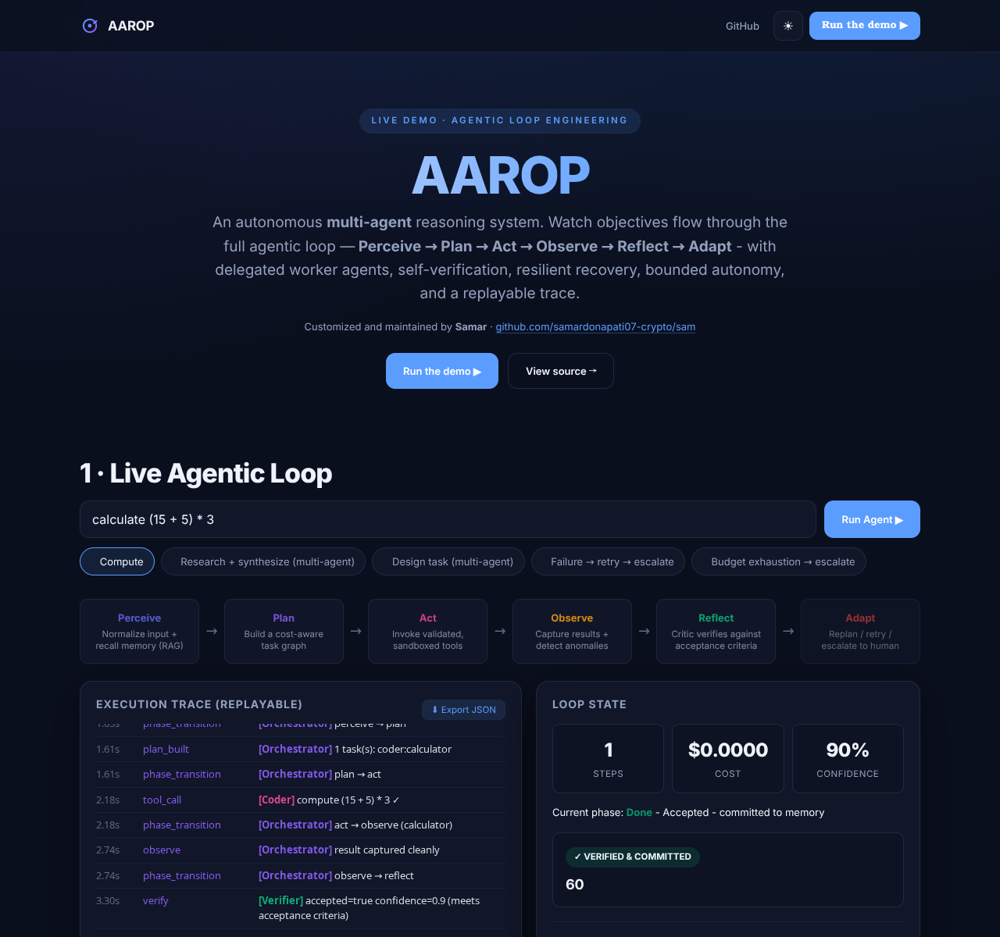
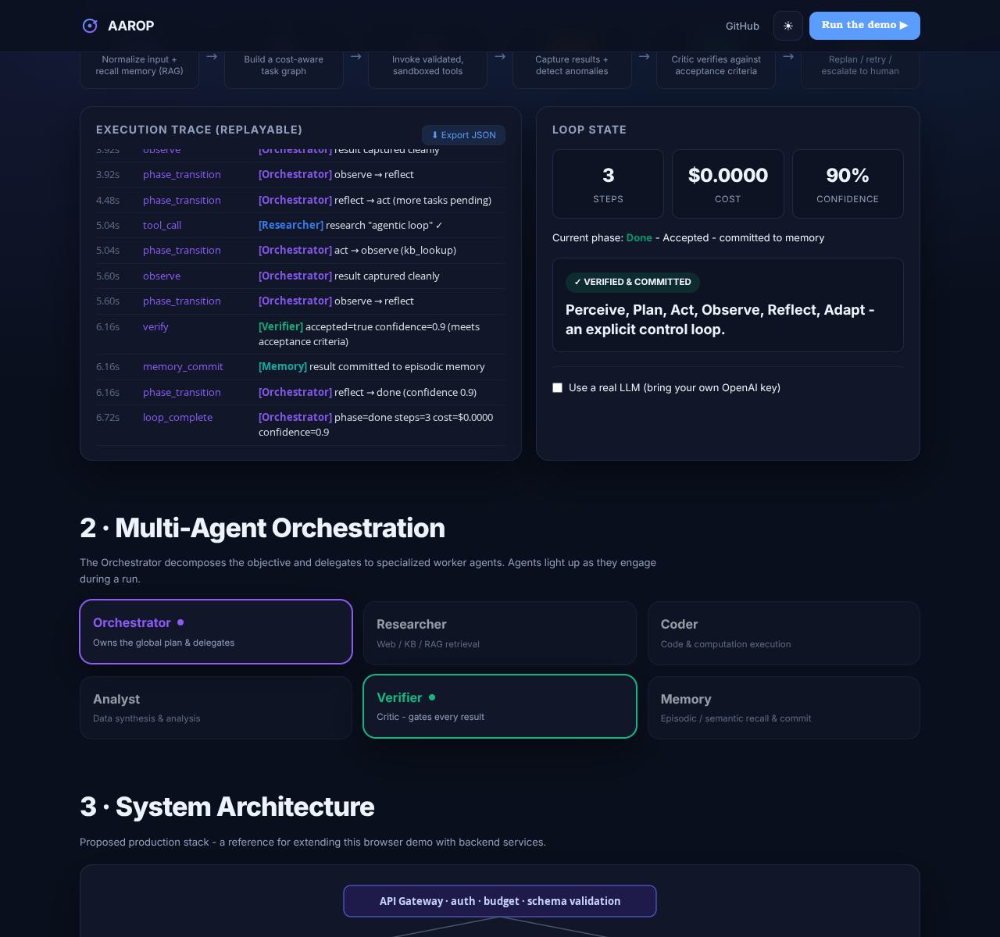
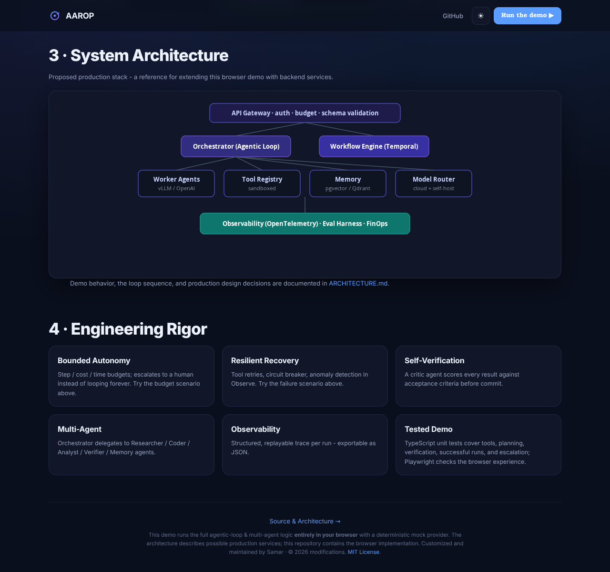

# AAROP — Agentic Loop Demo · Samar

An interactive demonstration of multi-agent orchestration. Enter an objective and watch it move through **Perceive → Plan → Act → Observe → Reflect → Adapt**, with tool calls, verification, recovery, budget limits, and an exportable execution trace.

**Customized and maintained by [Samar](https://github.com/samardonapati07-crypto).**

**Source:** [samardonapati07-crypto/sam](https://github.com/samardonapati07-crypto/sam) · **Demo engine:** [`lib/aarop.ts`](lib/aarop.ts) · **Architecture:** [`docs/ARCHITECTURE.md`](docs/ARCHITECTURE.md)

## Screenshots

Explore the live loop, multi-agent orchestration, and system architecture.

| Live agentic loop | Multi-agent orchestration |
| --- | --- |
|  |  |

| System architecture and engineering details |
| --- |
|  |

## Features

- **Explicit loop state machine:** phase transitions appear in the execution trace.
- **Agent roles:** Orchestrator, Researcher, Coder, Analyst, Verifier, and Memory are visualized during each run.
- **Multi-step plans:** research and design examples combine local knowledge lookups with synthesis.
- **Failure recovery:** the failure scenario demonstrates retries, a circuit breaker, and escalation.
- **Budget guardrails:** step, simulated cost, and time limits bound execution.
- **Trace export:** download a run's objective, events, and result as JSON.
- **Architecture view:** see how the demo could map to a production system.
- **Light and dark themes:** system-aware, with a saved manual preference.
- **Optional OpenAI narration:** use your own API key for a single explanation of the final result.

The default demo runs entirely in the browser with a deterministic mock provider and local tools. **No API key is needed.** Research uses a small built-in knowledge base; the displayed costs and confidence are demo values. The agent roles are simulated within one TypeScript loop.

## Run locally

Use **Node.js 22.13 or newer** and npm.

```bash
git clone https://github.com/samardonapati07-crypto/sam.git
cd sam
npm ci
npm run dev
```

Open [http://localhost:3000](http://localhost:3000).

## Try the demo

| Scenario | What to expect |
| --- | --- |
| Compute | Calculate `(15 + 5) * 3` and verify the result: `60`. |
| Research + synthesize | Retrieve local explanations of the agentic loop and RAG, then combine them. |
| Design task | Combine local notes about Temporal, vLLM, and pgvector. |
| Failure → retry → escalate | Inject tool failures and watch the run escalate after repeated errors. |
| Budget exhaustion → escalate | Stop a research run when its step budget is exhausted. |

After a run, select **Export JSON** to download the execution trace.

## Checks and production build

```bash
npm test
npm run typecheck
npx playwright install chromium
npm run test:e2e
npm run build
npm start
```

Unit tests cover the calculator, planner, verifier, successful execution, circuit breaker, and budget escalation. Browser tests cover the page, a successful calculation, budget escalation, and theme switching.

## Repository layout

| Path | Purpose |
| --- | --- |
| [`app/page.tsx`](app/page.tsx) | Demo UI, scenarios, agent visualization, and trace export. |
| [`app/layout.tsx`](app/layout.tsx) | Page metadata and theme initialization. |
| [`app/opengraph-image.tsx`](app/opengraph-image.tsx) | Social preview with Samar's project details. |
| [`components/ThemeToggle.tsx`](components/ThemeToggle.tsx) | Light/dark theme switch. |
| [`lib/aarop.ts`](lib/aarop.ts) | Browser loop, planner, tools, verifier, and optional narration. |
| [`lib/aarop.test.ts`](lib/aarop.test.ts) | Engine unit tests. |
| [`e2e/demo.spec.ts`](e2e/demo.spec.ts) | Playwright browser checks. |
| [`docs/ARCHITECTURE.md`](docs/ARCHITECTURE.md) | Implemented behavior and proposed production architecture. |
| [`docs/screenshots/`](docs/screenshots/) | README screenshots. |

This repository contains the browser demo. A Python engine, persistent database, hosted worker agents, and production infrastructure are not included.

## Deploy

1. Import [this repository](https://github.com/samardonapati07-crypto/sam) into your hosting provider.
2. Select the **Next.js** framework and the repository root as the project directory.
3. Use `npm ci` to install and `npm run build` to build.
4. Deploy. The default mock demo needs no API keys or server secrets.

On Vercel, metadata uses the production project domain automatically. On another host, optionally set `NEXT_PUBLIC_SITE_URL` to your deployed HTTPS URL for social preview links. Without a deployment URL, local metadata uses `http://localhost:3000`.

The optional real narration sends a request directly from the browser to OpenAI and may incur API charges. The API key stays in React state until the page is closed or refreshed; it is sent to OpenAI for that request. See [`SECURITY.md`](SECURITY.md) for details.

## Tech stack

Next.js 14 App Router · React 18 · TypeScript · Node.js test runner · Playwright

## License

MIT. Original copyright and permission notices are retained in [`LICENSE`](LICENSE); source provenance is documented in [`NOTICE.md`](NOTICE.md).

---

Customized and maintained by **Samar** · © 2026 modifications · [github.com/samardonapati07-crypto](https://github.com/samardonapati07-crypto)
